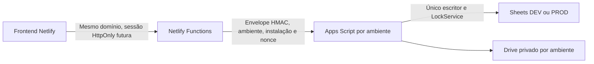

# V17 — Fase A: arquitetura e auditoria

## Estado real auditado

Base: `dev` em `56af7ab922b5a9c5cecbaacd2f4a218ce93b853f`. A interface é um único HTML com estilos e JavaScript inline. Não existiam backend, banco compartilhado, manifestos Node ou configuração Netlify no repositório.

O transporte `google.script.run` é emulado em memória e persiste `db` em localStorage. O login usa PINs públicos demonstrativos. A fila de checkout contém o payload do cliente; isso só é aceitável como demonstração fictícia, não como fila de operação real. A baixa de estoque é local e admite override após confirmação; isso não constitui integridade multiusuário. Imagens são URLs externas ou data URLs locais.

O indicador DEV depende do hostname exato. Catálogo, Caixa, Estoque, metadados/capas, galeria, Relatórios e PINs permanecem no protótipo. `index.html` não foi alterado nesta fase. O PR #4 de webcam/câmera continua separado e sem merge; esta fundação não incorpora silenciosamente aquela branch.

## Decisão de arquitetura

A API não aceita identidade, papel ou segredo vindo de campos do frontend. Functions serão responsáveis por sessão, autorização e validação dos comandos; Apps Script repetirá os controles de ambiente, instalação, assinatura e permissões da operação.

Nesta fase há apenas liveness público e inspeção de schema administrativa. A inspeção permanece **fechada**: a função de identidade falha deliberadamente enquanto a Fase C não for implementada. Não existe atalho por PIN demonstrativo, header `x-role`, variável de modo de teste ou localStorage.

O frontend não troca para o backend nesta entrega. Em futura ativação, modo real terá configuração explícita e nunca fará fallback para a base demonstrativa ao encontrar erro. A fila real não reaproveitará payloads pessoais ou sessões do protótipo; armazenará somente IDs e referências mínimas sem CPF/PIN, com revalidação no servidor.

## Limites aceitos e condições de implantação

- Sheets não oferece transações ACID em várias abas. `LockService` serializa o mesmo projeto Apps Script, não scripts diferentes que acessem a mesma planilha.
- Haverá um único projeto/escritor por instalação. Não conceder escrita direta a operadores; DEV e PROD precisam de identidades Google e permissões independentes. Marcadores e HMAC não substituem IAM.
- Apps Script/Sheets/Drive têm quotas e tempos máximos; o desenho é para baixo volume e deve ser medido antes da operação. Alta concorrência ou exigência de transações fortes justifica migrar o núcleo para PostgreSQL/serviço transacional e manter Sheets como relatório.
- `DriveApp` exige escopo amplo de Drive. O guia exige uma identidade DEV dedicada e sem acesso aos arquivos PROD. Se a organização não aceitar esse escopo ou não permitir web apps anônimos protegidos por assinatura, não ativar este caminho: avaliar serviço com identidade dedicada e permissões por recurso (por exemplo Cloud Run + API Google) antes da integração.
- Apps Script expõe o URL do web app, mas não operações sem assinatura. Não há CORS direto do browser, URL secreto na query ou endpoint de escrita administrativo público.
- A conta proprietária de uma planilha pode editar/apagar dados diretamente. A futura auditoria é append-only pela aplicação; retenção externa imutável e/ou ancoragem independente serão necessárias se a política exigir resistência contra alteração pelo proprietário.

Esses limites são documentados antes de conectar qualquer recurso real. Esta entrega não provisiona PROD.

## Integridade de vendas — contrato para Fase B

1. Validar sessão e papel na Function. Criar comando canônico, valores em centavos e chave idempotente; não confiar em total/preço/estoque do navegador.
2. Assinar o comando com contexto DEV/PROD e instalação. Apps Script valida o envelope e adquire o lock do projeto.
3. **Recuperar eventos pendentes antes de validar novo estoque.** Nenhuma nova venda pode ignorar uma venda já aceita mas ainda não projetada.
4. Consultar a chave idempotente no journal. Mesmo hash retorna a operação original; mesma chave com conteúdo diferente é conflito.
5. Validar produtos, versões e saldo. Estoque insuficiente rejeita sem evento de venda aceito. Sem override negativo no modo real.
6. Acrescentar um evento autoritativo de venda em `_Eventos_Dominio` e confirmar a gravação. Esse é o ponto de decisão recuperável; Vendas/Itens/Estoque/Auditoria são projeções.
7. Projetar com IDs determinísticos, versões esperadas e valores finais, nunca decrementos cegos em cada retry. Aplicar cada evento uma única vez por entidade. Atualizar o checkpoint de projeção por último.
8. Se houver interrupção, reexecutar as projeções sob lock e com versões verificadas. O cliente consulta/reenvia a mesma chave; não inventa outra venda nem informa sucesso antes da confirmação do servidor.

A Fase A não implementa nem afirma testar esse algoritmo de vendas. A Fase B exigirá testes de duas vendas concorrentes, falhas em cada projeção e recuperação sem saldo negativo ou duplicidade, além de medição no Google real.

## Modelo

`schema/workspace-v1.json` contém todos os cabeçalhos solicitados. Foram adicionadas apenas estruturas/campos justificados:

- `_Migracoes`: versão, fingerprint do schema e backup anterior à aplicação.
- `_Requisicoes`: hashes de nonces e expiração, para defesa persistente contra replay sob lock; não é um limitador de login.
- `_Eventos_Dominio`: journal autoritativo e checkpoint para recuperação da futura Fase B.
- `Sessoes.Token_Hash`, nível de autenticação e versão de autorização: suporte à futura revogação; nunca token bruto.
- `CPF_Indice` em Clientes/Usuarios e `Email_Indice` em Usuarios: busca exata por HMAC de chave privada, para não exigir CPF/e-mail em claro. Permanecem dados pessoais pseudonimizados.

Chaves primárias, vínculos, restrições e classificações constam do JSON. Sheets não impõe FK/unique automaticamente; a aplicação deverá validar essas regras sob lock na Fase B. Valores monetários são inteiros em centavos; datas canônicas ISO-8601 UTC, apresentação America/Sao_Paulo. Dados pessoais serão cifrados com AEAD e versão da chave fora da planilha antes de serem aceitos em modo real. Nenhum dado pessoal é gravado pela Fase A.

## Sequência de aprovação

| Fase | Escopo | Condição para avançar |
| --- | --- | --- |
| A — esta entrega | Arquitetura, schemas, migrações, adaptador fechado, testes e instalação | PR aprovado; instalação DEV real verificada quando houver autorização |
| B | Produtos/nichos/clientes, journal/vendas/estoque, Drive e sincronização | Testes de concorrência, recuperação, PII e isolamento; API de browser ainda fechada sem C |
| C | Identidade, bootstrap, convites, PIN, MFA/passkeys, sessões e autorização | Revisão de segurança e testes de abuso; somente então ativação de usuários reais |
| D | Auditoria, notificações, escalas, nichos gerenciáveis e relatórios | Permissões e projeções testadas por módulo |
| E | Checkout anônimo, fila offline segura e homologação final | Regressão multiusuário e aprovação explícita de operação |

Cada fase parte da `dev` então vigente, em nova branch e PR exclusivo para `dev`. Não fazer merge automaticamente nem ativar recursos/dados de PROD. A ordem B antes de C não autoriza expor persistência sem autenticação: o serviço de B será testado privadamente até C ser aprovado.
